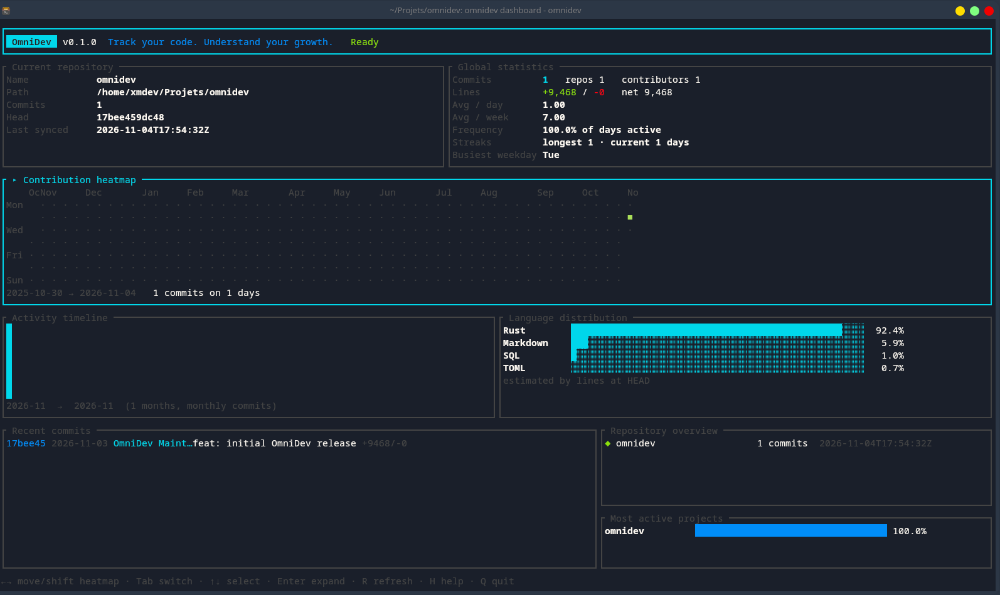
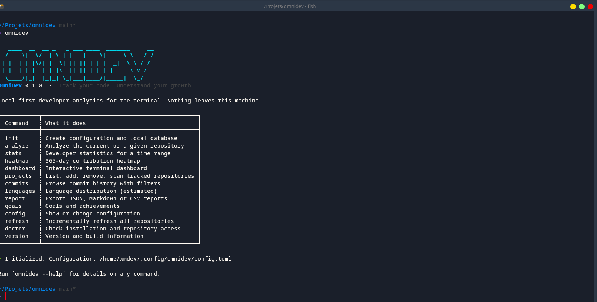
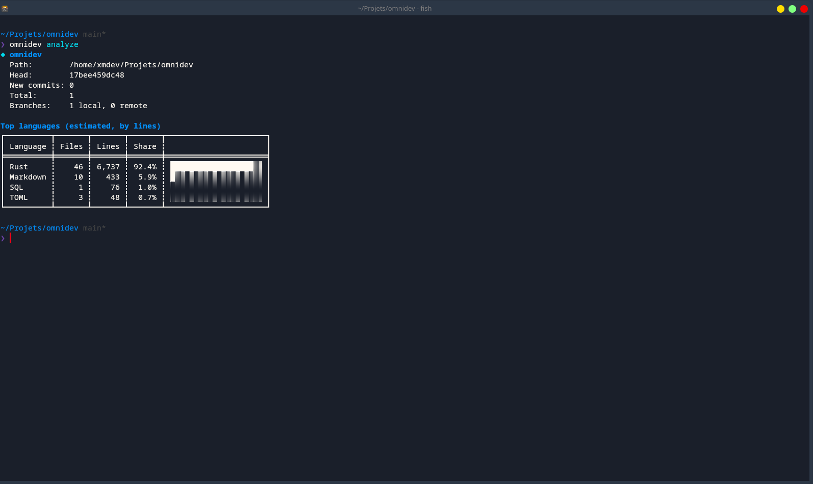
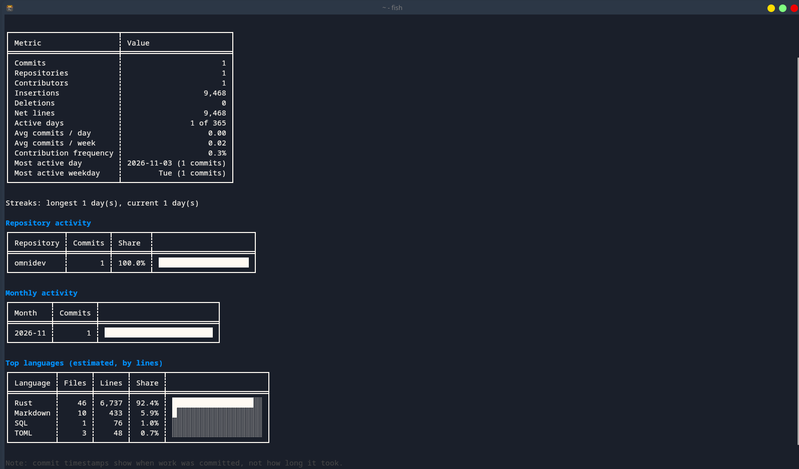

 <div align="center">

```
   ____  __  __ _   _ ___ ____  _______     __
  / __ \|  \/  | \ | |_ _|  _ \| ____\ \   / /
 | |  | | |\/| |  \| || || | | |  _|  \ \ / /
 | |__| | |  | | |\  || || |_| | |___  \ V /
  \____/|_|  |_|_| \_|___|____/|_____|\___/
```

**Track your code. Understand your growth.**

[](https://github.com/epxmdev/omnidev/actions/workflows/ci.yml)

[](LICENSE)
[](https://github.com/epxmdev/omnidev/releases)

**A local-first developer activity analytics platform for your terminal.**

</div>

OmniDev is a developer analytics platform built in Rust. It analyzes Git history, calculates development statistics, tracks language distribution and contribution activity, and presents everything in an interactive terminal dashboard.

Everything runs locally. No telemetry, no account and no cloud synchronization.

## Screenshots

### Dashboard


### Repository overview


### Analysis


### Statistics


## Features

- **Repository analysis** — Analyze local and remote branches with incremental synchronization.
- **Developer statistics** — Commits, contributors, insertions, deletions, streaks and activity averages.
- **Contribution heatmap** — Visualize your activity over the last 365 days.
- **Interactive dashboard** — Responsive terminal interface with keyboard navigation and help overlay.
- **Commit explorer** — Filter commits by author, date, message and repository.
- **Language distribution** — Estimate language usage from line counts.
- **Reports** — Export activity data in JSON, Markdown and CSV.
- **Goals and achievements** — Track development goals and progress.
- **Repository management** — Register, scan and manage tracked repositories.

## Installation

### Requirements

- Rust 1.85 or newer
- Cargo
- Git
- A C compiler and standard build tools

### CachyOS / Arch Linux

Install the build tools:

```bash
sudo pacman -Syu
sudo pacman -S --needed base-devel git
```

Check your tools:

```bash
rustc --version
cargo --version
git --version
```

If Rust is missing, install it using [rustup](https://rustup.rs/).

### Build from source

Clone the repository:

```bash
git clone https://github.com/epxmdev/omnidev.git
cd omnidev
```

Build and install:

```bash
cargo install --path .
```

Make sure Cargo's binary directory is in your PATH:

```bash
export PATH="$HOME/.cargo/bin:$PATH"
```

Add this line to `~/.bashrc` or `~/.zshrc` to keep it permanently.

Verify the installation:

```bash
omnidev --version
omnidev --help
```

## First launch

### 1. Initialize OmniDev

```bash
omnidev init
```

This initializes your local configuration and database.

### 2. Analyze a repository

Navigate to a Git repository:

```bash
cd ~/code/my-project
```

Analyze it:

```bash
omnidev analyze
```

You can also specify a path:

```bash
omnidev analyze --path ~/code/my-project
```

### 3. Open the dashboard

```bash
omnidev
```

Or explicitly:

```bash
omnidev dashboard
```

The dashboard runs directly in your terminal. Press `H` to open the help overlay and `Ctrl+C` to exit.

### 4. Explore your activity

```bash
omnidev stats --range 90d
omnidev heatmap
omnidev commits
omnidev languages
```

## Manage repositories

Register a repository:

```bash
omnidev projects add ~/code/api --name api
```

List tracked repositories:

```bash
omnidev projects list
```

Scan a directory for Git repositories:

```bash
omnidev projects scan --dir ~/code
```

Refresh tracked repositories:

```bash
omnidev refresh
```

## Command reference

| Command | Description |
|---|---|
| `omnidev init` | Initialize configuration and database |
| `omnidev` | Open the dashboard |
| `omnidev dashboard` | Launch the interactive dashboard |
| `omnidev analyze` | Analyze the current repository |
| `omnidev stats` | Display developer statistics |
| `omnidev heatmap` | Display contribution activity |
| `omnidev projects list` | List tracked repositories |
| `omnidev projects add PATH` | Register a repository |
| `omnidev projects scan` | Find repositories in a directory |
| `omnidev refresh` | Refresh tracked repositories |
| `omnidev commits` | Explore commit history |
| `omnidev languages` | Display language statistics |
| `omnidev report` | Generate an activity report |
| `omnidev goals` | View goals and achievements |
| `omnidev config` | Display configuration |
| `omnidev doctor` | Check installation and access |
| `omnidev --help` | Display available commands |

For all available options, see [docs/COMMANDS.md](docs/COMMANDS.md).

## Examples

```bash
omnidev commits --author "Ada" --range 30d --files

omnidev report --format csv --output activity.csv

omnidev report --format json --range 1y --repo api --output api-year.json

omnidev goals set weekly-commits 5
```

## Configuration and privacy

OmniDev stores configuration and activity data locally.

It is designed to keep your development data on your machine. Your Git history and usage data are not uploaded to a remote service.

See [docs/CONFIGURATION.md](docs/CONFIGURATION.md) for configuration options.

## Troubleshooting

### `omnidev: command not found`

Make sure Cargo's binary directory is in your PATH:

```bash
export PATH="$HOME/.cargo/bin:$PATH"
```

### Build errors

Check your Rust version and build tools:

```bash
rustc --version
cargo --version
gcc --version
```

On CachyOS:

```bash
sudo pacman -S --needed base-devel git
```

Then retry:

```bash
cargo install --path . -v
```

### Dashboard has no activity

Initialize OmniDev and analyze at least one Git repository:

```bash
omnidev init
cd ~/code/my-project
omnidev analyze
omnidev dashboard
```

## Development

Build the project:

```bash
cargo build
```

Run it from source:

```bash
cargo run -- --help
```

Run tests:

```bash
cargo test --all-targets
```

## Architecture

OmniDev is built in Rust with:

- `git2` for Git repository access
- `rusqlite` for local database storage
- `ratatui` for the terminal interface
- `crossterm` for terminal interaction

See [docs/ARCHITECTURE.md](docs/ARCHITECTURE.md) and [docs/DATABASE.md](docs/DATABASE.md).

## Roadmap

- Background dashboard refresh
- More detailed file ownership and churn analysis
- Configurable language mapping
- Packaged builds for Homebrew and winget

## Contributing

Contributions are welcome!

Read [CONTRIBUTING.md](CONTRIBUTING.md) before submitting a pull request.

## Security

See [SECURITY.md](SECURITY.md) for security information and vulnerability reporting.

## License

OmniDev is distributed under the MIT License. See [LICENSE](LICENSE).

---

<div align="center">

**Built with Rust. Made for developers.**

[GitHub Repository](https://github.com/epxmdev/omnidev)

</div>
